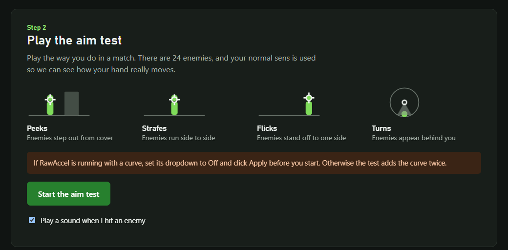
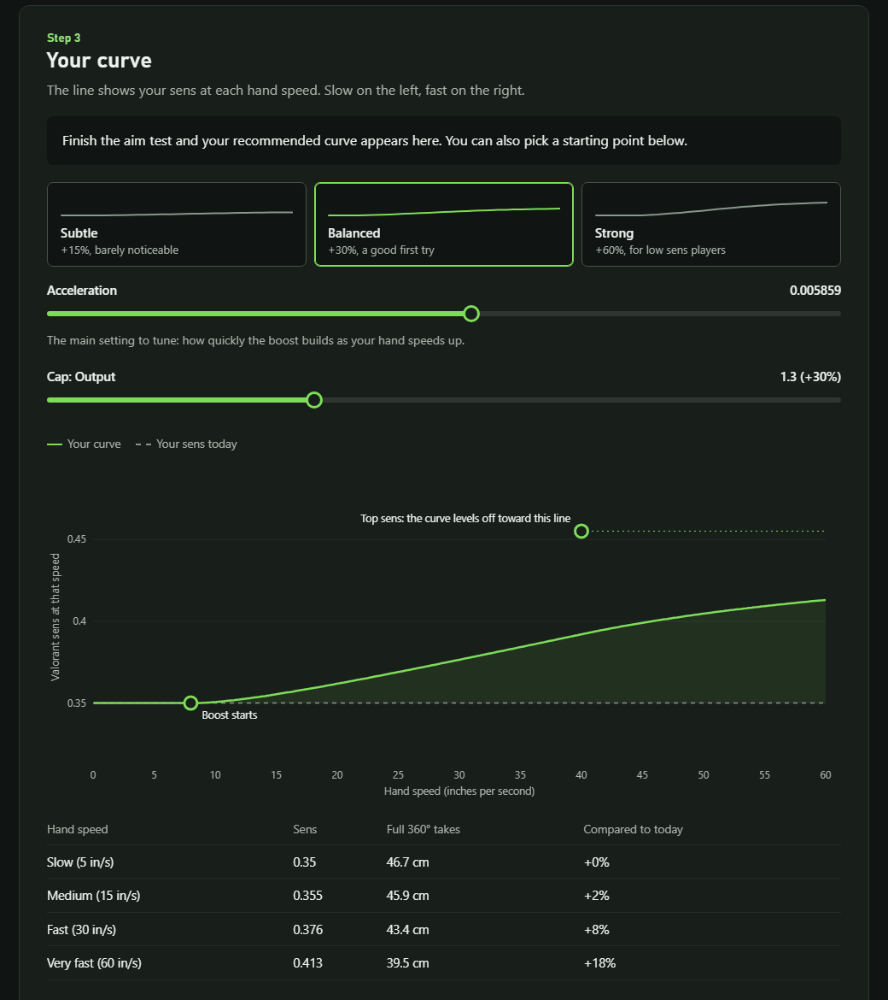

<p align="center">
  
</p>

Your crosshair placement wants a low sens. Your 180s want a high one. A mouse curve gives you both: sens stays put while your hand moves slowly and climbs only when you swing fast.

Sensline finds that curve from how you actually aim. You play a short Valorant-style test, it reads your hand speeds, and it writes a `settings.json` for [RawAccel](https://github.com/RawAccel/rawaccel), the free mouse acceleration driver for Windows.

<p align="center">
  
</p>

## From your mouse to RawAccel in four steps

**1. Your mouse.** Enter your DPI and Valorant sens. Already running RawAccel? Load your current `settings.json` or type in your panel values, and Sensline converts them so you start from the curve you know.

**2. The aim test.** 24 enemies across peeks, strafes, flicks and turns, played at your normal sens. Sensline records how fast your hand moves in each one.

<p align="center"></p>

**3. Your curve.** You get a recommended curve, or you can start from Subtle, Balanced or Strong. Acceleration is the main dial. Cap: Output sets how high the curve can go.

<p align="center"></p>

**4. Install.** Pick your RawAccel version (1.6 or 1.7), download the file, and check it against the same field names you see in the app.

<p align="center"></p>

## What the curve does to your sens

This is the Balanced preset at 800 DPI and 0.35 sens. Slow aim is untouched. The boost only shows up once your hand is really moving.

| Hand speed | Sens | Full 360° | Compared to no curve |
| :-- | --: | --: | --: |
| Slow, 5 in/s | 0.350 | 46.7 cm | +0% |
| Medium, 15 in/s | 0.355 | 45.9 cm | +2% |
| Fast, 30 in/s | 0.376 | 43.4 cm | +8% |
| Very fast, 60 in/s | 0.413 | 39.5 cm | +18% |

## Fix it by feel

Play a few games, then tell Sensline what went wrong. Each button makes one small change and can be undone.

| What you notice | What changes |
| :-- | :-- |
| I flick past targets | Acceleration down 15% |
| I stop short of targets | Acceleration up 15% |
| Big turns take too much arm | Cap: Output up 0.05 |
| Fast swings feel out of control | Cap: Output down 0.05 |
| Small aim feels jumpy | The boost starts later |

## What it writes into RawAccel

Sens Multiplier stays at 1 and the device DPI stays at 0, so Valorant sens keeps meaning what it always did. Everything the curve does lives in Acceleration, the cap and the offset. For the Balanced preset above, the RawAccel 1.7 panel reads:

```text
Sens Multiplier   1            Linear, Gain on
Acceleration      0.005859     Cap Type      Output
Cap: Output       1.3          Input Offset  6.4
Device DPI        0            Polling rate  0
```

Linear, Classic, Natural and Synchronous curves are all supported, and files work with RawAccel 1.6 and 1.7.

## Your data stays on your PC

There is no account and no server. Tests and settings are saved in your browser on that device. You can download them as CSV or JSON, restore them from a backup, or delete them from the page.

## Run it

Open `index.html` in a browser. That's the whole app.

<details>
<summary><b>Editing the page</b></summary>

<br>

The page's security policy only allows code that matches fingerprints stored in the page. After any edit to `index.html`, refresh them:

```bash
node update-csp.js
```

The README banner is `assets/banner.svg`. It draws the Balanced curve from the app's own math and plays a short animation, which stays still for people who turn off motion.

</details>

## License

Proprietary. All rights reserved. See [LICENSE](LICENSE) and [THIRD_PARTY_NOTICES.md](THIRD_PARTY_NOTICES.md).

Sensline is not affiliated with RawAccel or Riot Games.
