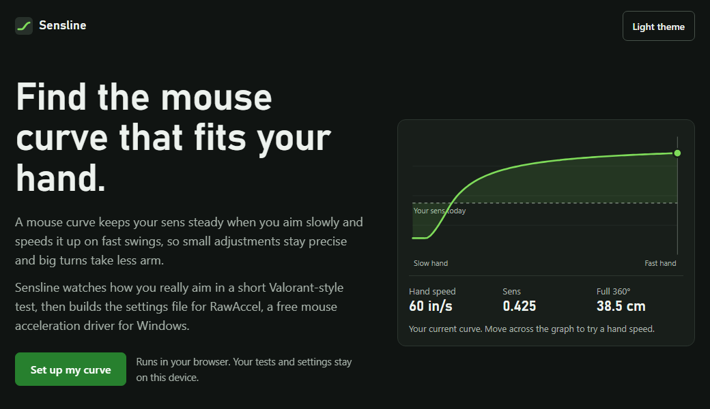
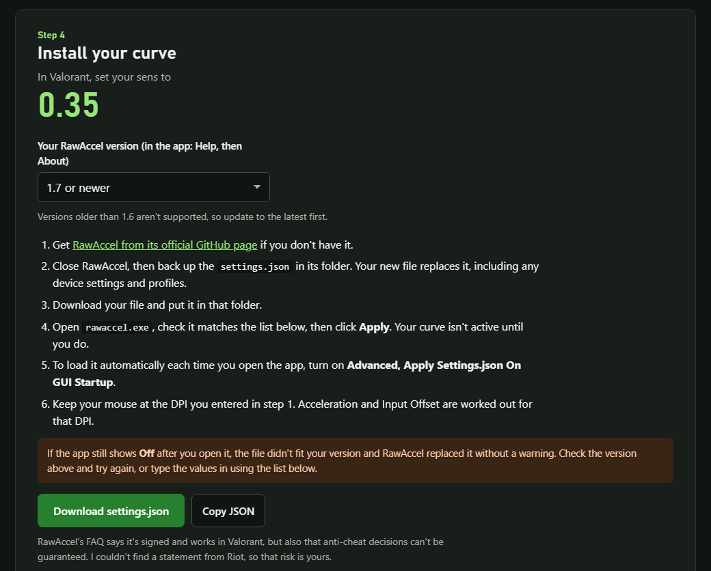

<p align="center">
  
</p>

Micro adjustments and tracking want a low sens. Flicks want the sens your muscle memory knows. Dodges and 180s want more. A mouse curve gives you all three: low while your hand barely moves, your normal sens through a flick, higher when you really swing.

Sensline builds that curve from how you actually aim. You play a short Valorant-style test, it measures your hand speeds and where your flicks land, and it writes a `settings.json` for [RawAccel](https://github.com/RawAccel/rawaccel), the free mouse acceleration driver for Windows.

<p align="center">
  
</p>

## From your mouse to RawAccel in four steps

**1. Your mouse.** Enter your DPI and Valorant sens. Already running RawAccel? Load your current `settings.json` or type in your panel values, and Sensline converts them so you start from the curve you know.

**2. The aim test.** 31 enemies across six drills, played at your normal sens with a rifle in hand. Sensline reads every mouse report and records how fast your hand moves.

| Drill | What happens | What it measures |
| :-- | :-- | :-- |
| Peeks | Enemies step out from cover | Small, quick corrections |
| Micro | A second enemy appears right beside your aim | Whether a tiny correction lands on the first shot |
| Strafes | Enemies run side to side in uneven bursts, like real players | Hitting a moving head |
| Flicks | Enemies stand off to one side | Where your first flick stops, before you correct it |
| Turns | Enemies appear behind you | Big swings |
| Tracking | Hold your crosshair on a moving enemy, no clicking | How much of the time you stay on target |

<p align="center"></p>

When you finish, you see kills, headshots and time per kill for each drill, plus two charts. The shot map draws every click where it landed around the enemy's real hitbox, so you can see which way you miss. The flick landing chart shows where each first flick stopped: short of the head, on it, or past it.

**3. Your curve.** You get a recommended curve, or you can start from Light, Balanced or Precise. Three numbers sit above the graph: your micro aim sens, the sens your flicks feel like, and your sens on big swings. Set micro aim with its own slider, and leave "Keep flicks feeling the same" on so your flicks don't drift while you tune.

<p align="center"></p>

**4. Install.** Pick your RawAccel version (1.6 or 1.7), download the file, and check it against the same field names you see in the app. The page tells you the sens to type into Valorant, which is your micro aim sens.

<p align="center"></p>

## How the curve keeps your flicks

A flick speeds up and slows down, and the crosshair covers most of the distance near the fastest part. So the sens a flick feels like is the average along that whole motion, not the sens at any one speed. Sensline works out that average for a flick at your measured peak speed, then picks Acceleration so it equals your sens today. Micro aim can sit as low as you like, and your flick distances stay where your muscle memory expects them.

This is the Balanced preset at 800 DPI and 0.35 sens:

| Hand speed | Sens | Full 360° | Compared to today |
| :-- | --: | --: | --: |
| Micro aim and tracking, under 3 in/s | 0.297 | 54.9 cm | -15% |
| Slow, 5 in/s | 0.308 | 52.9 cm | -12% |
| **A whole flick peaking at 12 in/s, on average** | **0.350** | **46.7 cm** | **Same** |
| Medium, 15 in/s | 0.386 | 42.3 cm | +10% |
| Fast, 30 in/s | 0.412 | 39.7 cm | +18% |
| Very fast, 60 in/s | 0.425 | 38.5 cm | +21% |

| Preset | Micro aim | Flicks | Big swings, 60 in/s |
| :-- | --: | --: | --: |
| Light | -8% | Same | +13% |
| Balanced | -15% | Same | +21% |
| Precise | -25% | Same | +30% |

After the aim test, the recommended curve is built from your own numbers:

- **Your flick speed** replaces the 12 in/s default.
- **Your tracking score** sets micro aim. If your crosshair stayed on the enemy under 55% of the time, micro aim goes to 75% of your sens. At 85% or more it only drops to 90%.
- **Your flick landing** adjusts flicks. If your first flicks land past the head, flicks get a little slower. If they land short, a little faster.

## Fix it by feel

Play a few games, then tell Sensline what went wrong. Each button makes one small change and can be undone.

| What you notice | What changes |
| :-- | :-- |
| I flick past targets | Acceleration down 15% |
| I stop short of targets | Acceleration up 15% |
| Big turns take too much arm | Cap: Output up 0.05 |
| Fast swings feel out of control | Cap: Output down 0.05 |
| Small aim feels jumpy | The boost starts later |

## What it writes into RawAccel

Sens Multiplier stays at 1 and the device DPI stays at 0. Your Valorant sens becomes your micro aim sens, and everything above it lives in Acceleration, the cap and the offset. For the Balanced preset above, set Valorant to 0.297 and the RawAccel 1.7 panel reads:

```text
Sens Multiplier   1            Linear, Gain on
Acceleration      0.057723     Cap Type      Output
Cap: Output       1.470588     Input Offset  2.4
Device DPI        0            Polling rate  0
```

Linear, Classic, Natural and Synchronous curves are all supported, and files work with RawAccel 1.6 and 1.7.

## Your data stays on your PC

There is no account and no server. Tests and settings are saved in your browser on that device. You can download them as CSV or JSON, restore them from a backup, or delete them from the page.

## Run it

Open `index.html` in a browser. That's the whole app.

<details>
<summary><b>Editing the page</b></summary>

<br>

The page's security policy only allows code that matches fingerprints stored in the page. After any edit to `index.html`, refresh them:

```bash
node update-csp.js
```

The README banner is `assets/banner.svg`. It draws the Balanced curve from the app's own math and plays a short animation, which stays still for people who turn off motion. The screenshots in `assets/` show the page with its default settings.

</details>

## License

Proprietary. All rights reserved. See [LICENSE](LICENSE) and [THIRD_PARTY_NOTICES.md](THIRD_PARTY_NOTICES.md).

Sensline is not affiliated with RawAccel or Riot Games.
